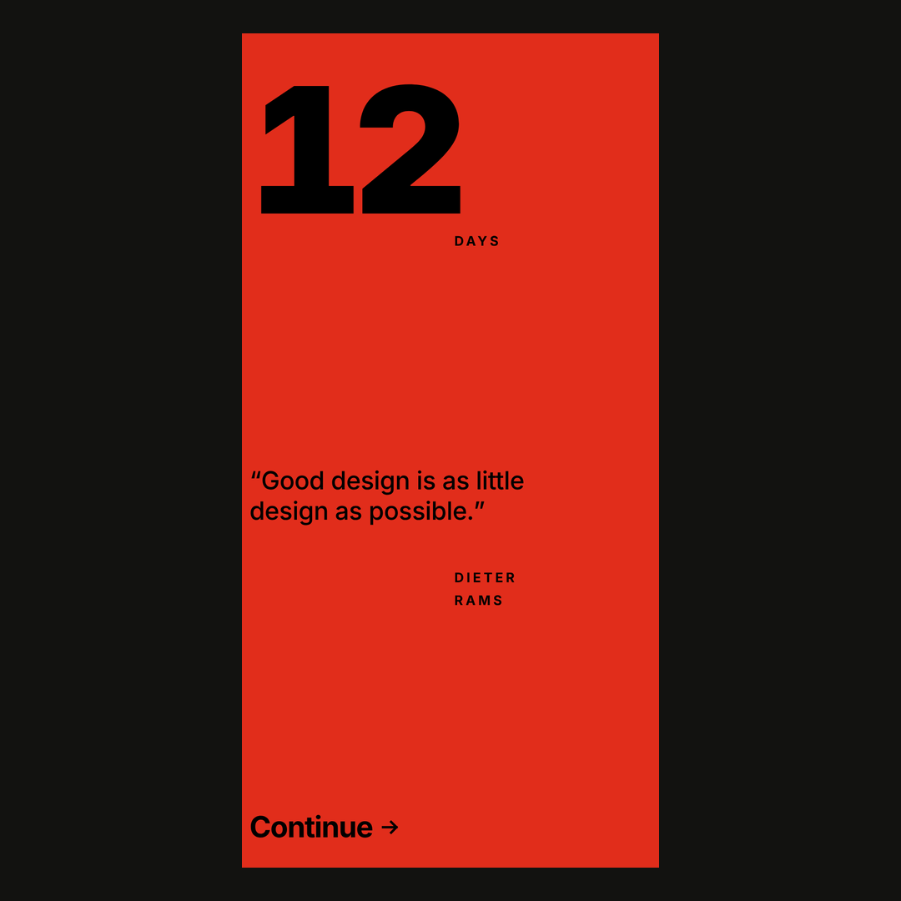

<!-- Design Speak — README -->

**English** · [Русский](#design-speak--русский)

# Design Speak


**A trainer that teaches designers to talk about their work — in English.**



UI/UX and product designers often do strong work but describe it in flat, generic words, especially in English: no structure, no decision, no result. Design Speak trains that missing skill — word by word, phrase by phrase, always in a real design context. A polished case study is the by-product; the skill is the point.

## What it is

- A **learning roadmap**, not a one-shot case generator. You build the skill of explaining design, in order.
- The atom of every lesson is **word → grammar form → phrase construction**, always on real design material ("I made the button an accent colour **so that** it stands out as the primary action").
- **Bilingual (EN / RU).** Rules and hints are available in Russian and can be switched off.
- **PWA, offline-first, no account.** Progress lives in the browser. No paid tiers; donations optional.

## Program structure

17 units across three levels:

| Level | Theme | Units |
|-------|-------|-------|
| **A** | About yourself | 1–4 — Background · Path into design · What inspires me · How I work |
| **B** | Language of decisions | 5–9 — Visual decisions · Hierarchy & attention · Cause & effect · Past tense of actions · Before / after |
| **C** | Whole project | 10–17 — Client & context · Task & JTBD · Constraints · Hypothesis · Testing · Results & metrics · Tradeoffs · Reflection |

**Progression.** The first lesson of every level is open from the start, so you can begin anywhere and skip level A. Each following lesson unlocks when the previous one in its level is complete. 100% = all 17 units done.

## How a lesson works

Each unit runs four exercise types in sequence:

1. **Pick the stronger** — choose the version a native speaker would actually say, and see why.
2. **Fix the tense** — rewrite a present-tense sentence into the past (what you *did*).
3. **Build the sentence** — assemble one strong phrase from a word bank (word-order task; the Russian translation is an optional hint).
4. **Your own screen** — write about your own work against a template, then self-check against a model answer and a checklist.

Alongside the units, a **flashcard deck** (spaced-repetition style) drills the vocabulary and idioms separately.

## Tech

- **Single self-contained HTML page** — no framework, no build step. Opens straight as a file.
- **State in `localStorage`** (`ds.state` = completed units + learned cards; `ds.streak` / `ds.lastDay` for the daily streak). Everything on the Progress screen is computed from real state.
- **Content** is authored in semi-structured Markdown unit files (one per unit) and wired into the app as data, so every lesson carries its own exercises.

## Run it

It's a static page — no dependencies.

```bash
# clone, then just open the file
open index.html          # macOS
# or serve it for full PWA behaviour:
python3 -m http.server 8000   # then visit http://localhost:8000/index.html
```

## Roadmap

- End-of-unit test as the real gate before the next lesson.
- Full flashcard decks (per-unit vocabulary + the idioms set).
- Progress backup — export / import (currently a placeholder).
- `navigator.storage.persist()` to resist storage eviction on iOS.

## Distribution

Shared with the designer community via LinkedIn and Telegram. Built by [Ivan Ledkov](https://ledkov.design).

## License

[MIT](LICENSE) © Ivan Ledkov.

---

<a id="design-speak--русский"></a>

[English](#design-speak) · **Русский**

# Design Speak


**Тренажёр, который учит дизайнеров рассказывать о своей работе — на английском.**

UI/UX- и продуктовые дизайнеры часто делают сильную работу, но описывают её плоско и общо, особенно по-английски: без структуры, без решения, без результата. Design Speak тренирует именно этот навык — слово за словом, фраза за фразой, всегда в реальном дизайнерском контексте. Готовый кейс получается как побочный продукт; главное — навык.

## Что это

- Это **маршрут обучения**, а не генератор кейса за один присест. Навык рассказывать о дизайне набирается по порядку.
- Атом каждого урока — **слово → грамматическая форма → конструкция фразы**, всегда на реальном дизайн-материале («I made the button an accent colour **so that** it stands out as the primary action»).
- **Два языка (EN / RU).** Правила и подсказки есть на русском и отключаются.
- **PWA, работает офлайн, без аккаунта.** Прогресс хранится в браузере. Платной подписки нет; возможны донаты.

## Структура программы

17 юнитов в трёх уровнях:

| Уровень | Тема | Юниты |
|---------|------|-------|
| **A** | About yourself | 1–4 — Background · Path into design · What inspires me · How I work |
| **B** | Language of decisions | 5–9 — Visual decisions · Hierarchy & attention · Cause & effect · Past tense of actions · Before / after |
| **C** | Whole project | 10–17 — Client & context · Task & JTBD · Constraints · Hypothesis · Testing · Results & metrics · Tradeoffs · Reflection |

**Прогрессия.** Первый урок каждого уровня открыт сразу — можно начать с любого места и пропустить уровень A. Следующий урок открывается, когда пройден предыдущий урок того же уровня. 100% — когда пройдены все 17 юнитов.

## Как устроен урок

В каждом юните подряд идут четыре типа упражнений:

1. **Pick the stronger** — выбрать формулировку, которую действительно сказал бы носитель, и увидеть почему.
2. **Fix the tense** — переписать предложение из настоящего в прошедшее (что ты *сделал*).
3. **Build the sentence** — собрать сильную фразу из банка слов (задание на порядок слов; русский перевод — опциональная подсказка).
4. **Your own screen** — написать про свою работу по шаблону и проверить себя по модельному ответу и чек-листу.

Помимо юнитов, есть **колода карточек** (в духе интервального повторения) — отдельно прокачивает слова и идиомы.

## Технологии

- **Одна самодостаточная HTML-страница** — без фреймворка и сборки. Открывается прямо как файл.
- **Состояние в `localStorage`** (`ds.state` = пройденные юниты и выученные карточки; `ds.streak` / `ds.lastDay` — дневной стрик). Всё на экране Progress считается из реального состояния.
- **Контент** написан в полуструктурированных Markdown-файлах юнитов (по файлу на юнит) и подключён в приложение как данные, поэтому у каждого урока свои упражнения.

## Запуск

Это статическая страница — без зависимостей.

```bash
# клонировать и просто открыть файл
open index.html          # macOS
# или поднять сервером для полноценного PWA:
python3 -m http.server 8000   # затем открыть http://localhost:8000/index.html
```

## Планы

- Тест в конце юнита как реальный гейт перед следующим уроком.
- Полные колоды карточек (словарь по юнитам + набор идиом).
- Бэкап прогресса — экспорт / импорт (сейчас заглушка).
- `navigator.storage.persist()` против вытеснения хранилища на iOS.

## Распространение

Расходится по дизайнерскому сообществу через LinkedIn и Telegram. Автор — [Иван Ледков](https://ledkov.design).

## Лицензия

[MIT](LICENSE) © Иван Ледков.
